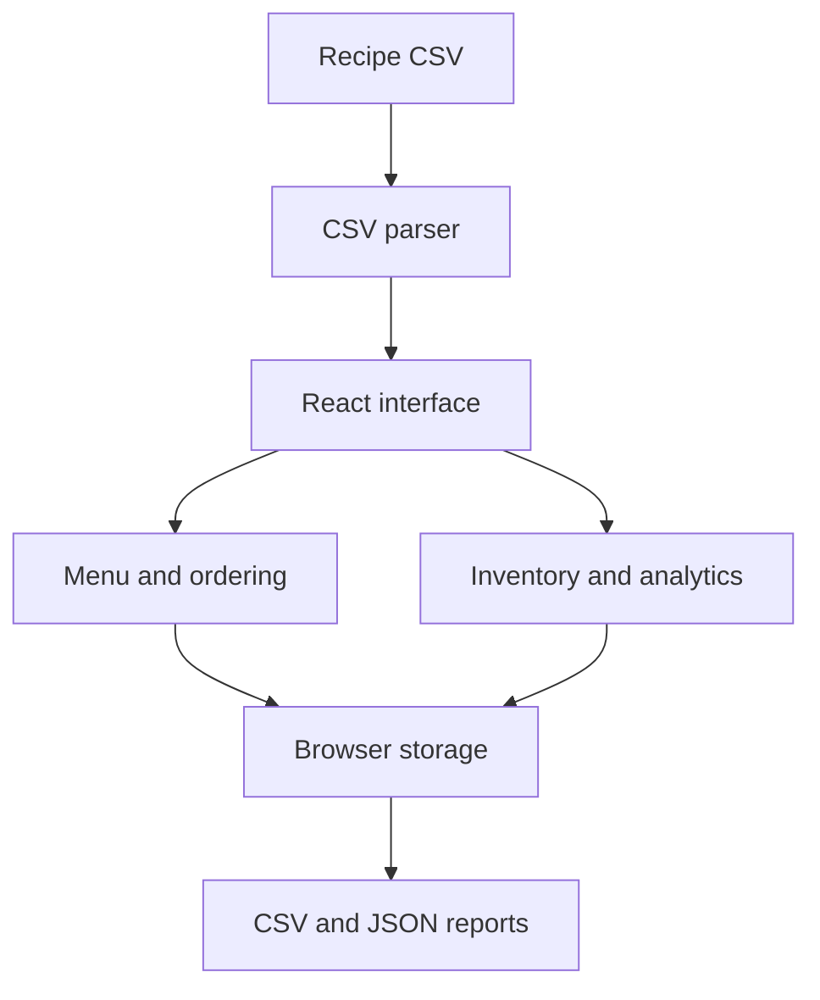

<div align="center">

# Food Inventory & Restaurant Operations

**Restaurant operations, organized in one interface.**

`React 18` · `TypeScript` · `Vite` · `Tailwind CSS`

[Portfolio](https://vekeshportfolio.lovable.app/) · [Developer profile](https://github.com/Vekesh04)

</div>

> **Publication status:** Documentation is published. The cleaned React source is prepared and awaiting upload.

## Overview

A restaurant management prototype combining a CSV-driven menu, customer ordering, ingredient tracking, purchase management, and operational reporting. It brings customer and administrator workflows into a single React application.

## Highlights

- Browse dishes with search, filters, ingredient details, and a shopping cart.
- Track orders, payment records, and customer sessions.
- Manage dishes, ingredients, inventory, and purchases through the admin dashboard.
- Calculate ingredient usage by servings and review availability.
- Explore date-based analytics and export CSV or JSON reports.

## Architecture



## Run locally

Install Node.js with npm, then run:

```bash
npm install
npm run dev
```

Open the local address printed by Vite. To create a production bundle:

```bash
npm run build
npm run preview
```

The menu loads from `public/indian_food.csv`; ingredient calculations and storage helpers are under `src/utils/`.

## Repository guide

| Path | Purpose |
| --- | --- |
| `src/App.tsx` | Application state and workflow coordination |
| `src/components/` | Menu, cart, login, inventory, and reporting interfaces |
| `src/utils/` | CSV parsing, ingredient calculations, persistence, and exports |
| `src/types/` | TypeScript models |
| `public/indian_food.csv` | Included food dataset |
| `manage.py`, `templates/` | Legacy Python/template files; not the Vite entry point |

## Prototype boundaries

This uploaded version uses browser local/session storage, including the helper named `cloudStorage`; it is not a deployed cloud database. Payment records and administrator authentication are demonstration workflows. The public demo admin password is `demo-admin-only` (see `AdminLogin.tsx` for the demo username). Do not use real payment or customer data. Some initial stock and rating values are generated for demonstration. No trained forecasting model is included in this archive.

## Author

**Vekesh Makani** · AI Engineer & Python Developer

[Portfolio](https://vekeshportfolio.lovable.app/) · [LinkedIn](https://linkedin.com/in/vekesh-m)
